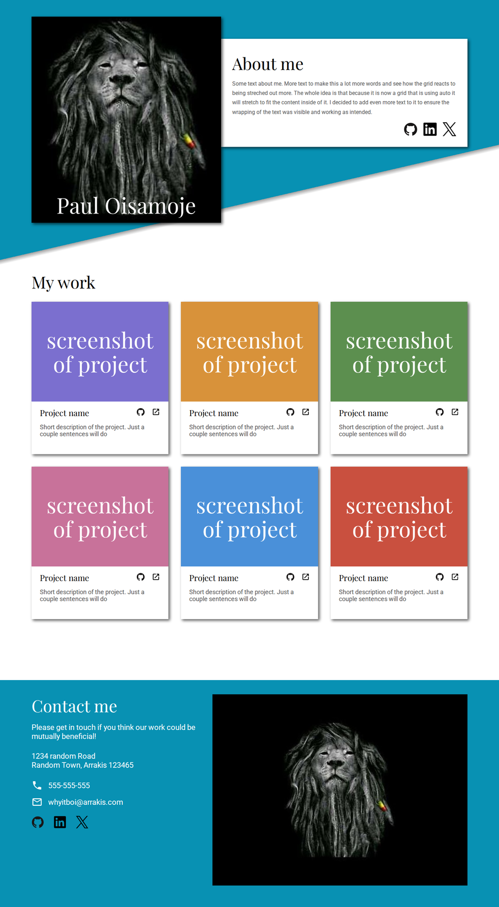

# Homepage-Project

A responsive personal homepage with an "About me" section, a grid of project cards and a contact footer. The layout adapts to mobile, tablet and desktop screens and holds up from 320px to 1920px wide.

**Live page:** https://whyitboi.github.io/homepage/



## Built with

- HTML
- CSS (Grid, Flexbox, media queries, `<picture>` for responsive images)
- [webpack](https://webpack.js.org/) for bundling

## Running it

Install the dependencies first:

```
npm install
```

Then:

| Command          | What it does                                                  |
| ---------------- | ------------------------------------------------------------- |
| `npm run dev`    | Starts a local development server                             |
| `npm run build`  | Creates the production build in `dist/`                       |
| `npm run deploy` | Publishes `dist/` to the `gh-pages` branch for GitHub Pages   |

`npm run deploy` publishes what is committed in `dist/`, and `dist/` is listed in `.gitignore`. So run `npm run build`, then `git add -f dist` and commit, and only then `npm run deploy`.

## About this project

This is [The Odin Project's Homepage project](https://www.theodinproject.com/lessons/node-path-advanced-html-and-css-homepage) from the Advanced HTML and CSS course. The text, project links and contact details are placeholders.
